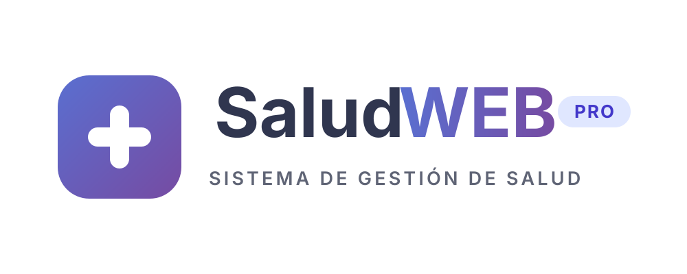

# Logo SaludWEB para Canva

Paquete de logo basado en la identidad visual existente de SaludWEB: tipografía, distintivo PRO y colores de marca, con un isotipo nuevo de signo más médico centrado.

## Archivos principales

| Archivo | Uso recomendado |
| --- | --- |
| `saludweb-logo-principal.svg` / `.png` | Logo horizontal completo para fondos claros: isotipo + SaludWEB + PRO + subtítulo. |
| `saludweb-logo-principal-blanco.svg` / `.png` | Misma versión en blanco para fondos oscuros, fotos o placas de color. |
| `saludweb-isotipo.svg` / `.png` | Ícono cuadrado solo con el signo más, para foto de perfil, app, sello o marca de agua. |
| `saludweb-cuadrado-saludweb-pro.svg` / `.png` | Versión cuadrada con el signo más y la marca completa “SaludWEB PRO” y subtítulo. |
| `saludweb-horizontal-gradiente.svg` / `.png` | Versión tipo banner con fondo degradado, ideal para portada o presentación. |
| `saludweb-horizontal-claro.svg` / `.png` | Versión solo texto para fondos claros y transparentes. |
| `saludweb-horizontal-blanco.svg` / `.png` | Versión solo texto en blanco para fondos oscuros. |

Los PNG tienen fondo transparente, salvo `saludweb-horizontal-gradiente`, que incluye el fondo degradado. Están exportados al doble de tamaño para mantener nitidez al escalarlos en Canva.

## Cómo usarlo en Canva

1. Entrar en Canva y abrir **Subir** > **Archivos**.
2. Subir el `.svg` si querés conservar la máxima calidad o el `.png` si preferís una imagen lista para arrastrar.
3. Arrastrar el logo al diseño y escalarlo desde una esquina para no deformarlo.
4. Para fondos oscuros usar la versión `-blanco`; para fondos claros usar la versión principal.
5. Si Canva reemplaza la tipografía al importar el SVG, seleccionar el texto y aplicar **Inter**, **Montserrat** o **Poppins** en Bold.

## Colores de marca

- Primario: `#5a6fd0`
- Primario fuerte: `#4a5cba`
- Secundario: `#764ba2`
- Degradado: `linear-gradient(135deg, #5a6fd0 0%, #764ba2 100%)`
- Texto marca oscuro: `#30364f`
- Texto marca claro: `#5669c6`
- Píldora PRO: fondo `#e0e7ff`, texto `#4338ca`
- Subtitle: `#5f6475`

## Tipografía

- Principal: **Inter** o **Montserrat**
- Peso: **Bold 700** para “SaludWEB” y “PRO”; **SemiBold 600** para el subtítulo.
- Alternativas: **Poppins**, **Open Sans** o **Segoe UI**.

## Tamaños de exportación sugeridos en Canva

- Presentación 16:9: logo principal de 500 a 700 px de ancho.
- Portada o banner: versión degradada a 1600 px de ancho.
- Perfil o app: isotipo en 1024 x 1024 px.
- Documento A4: logo principal de 4 a 5 cm de ancho.
